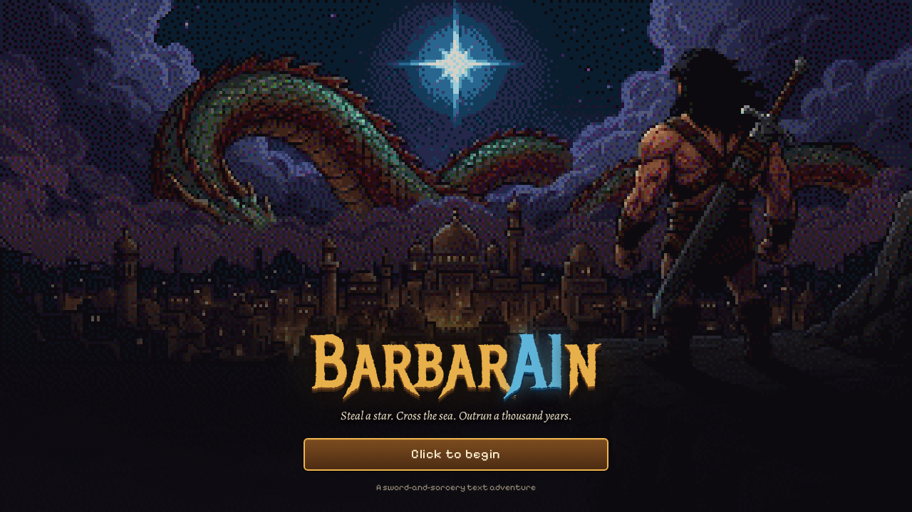
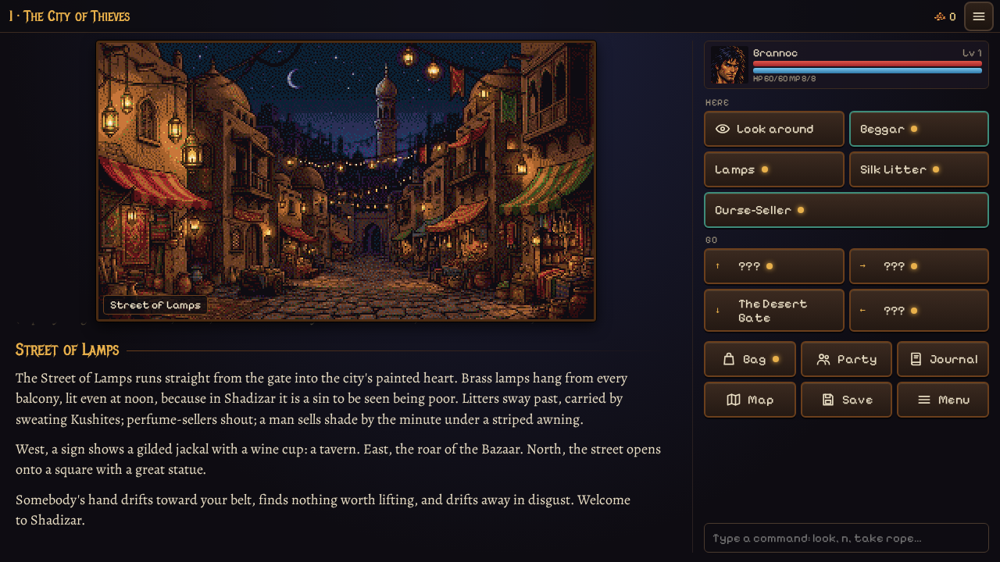
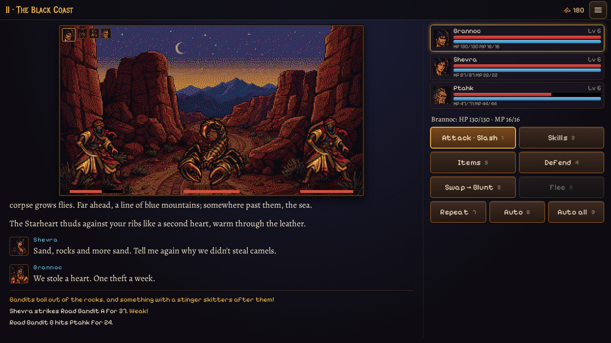
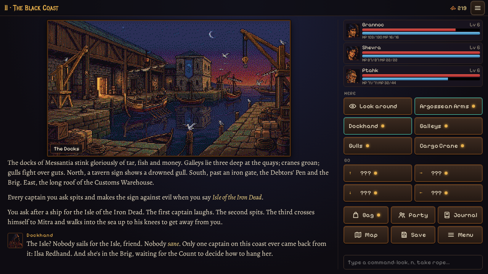
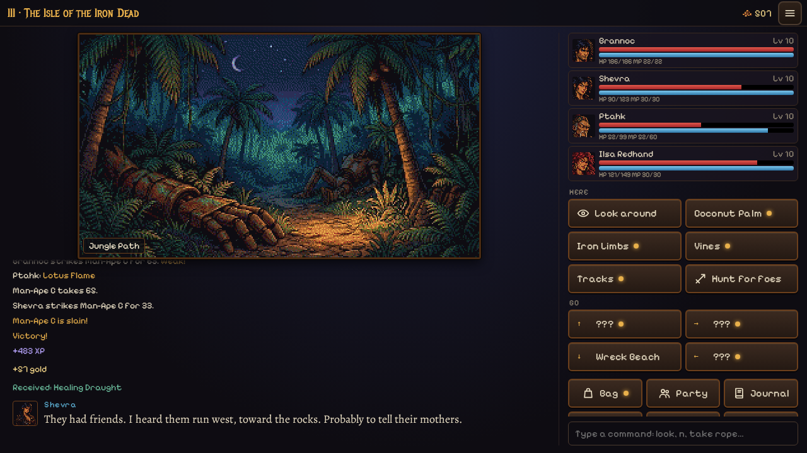
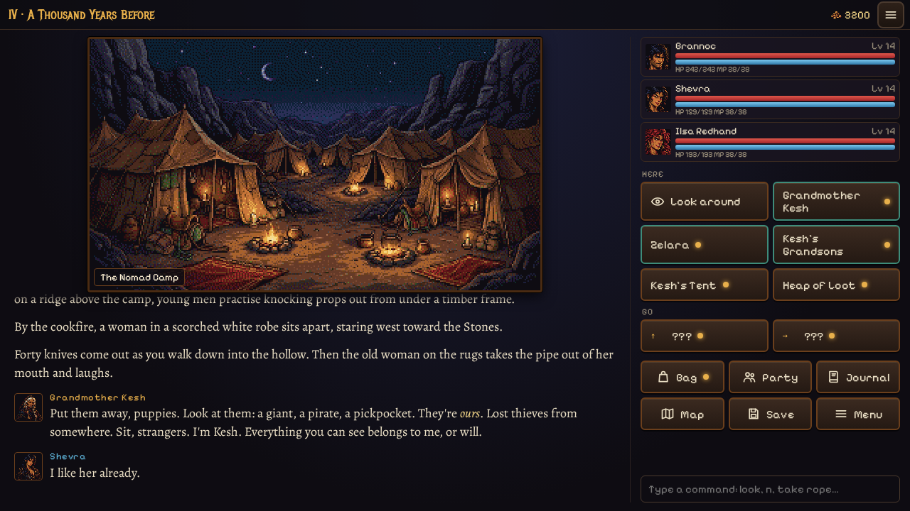
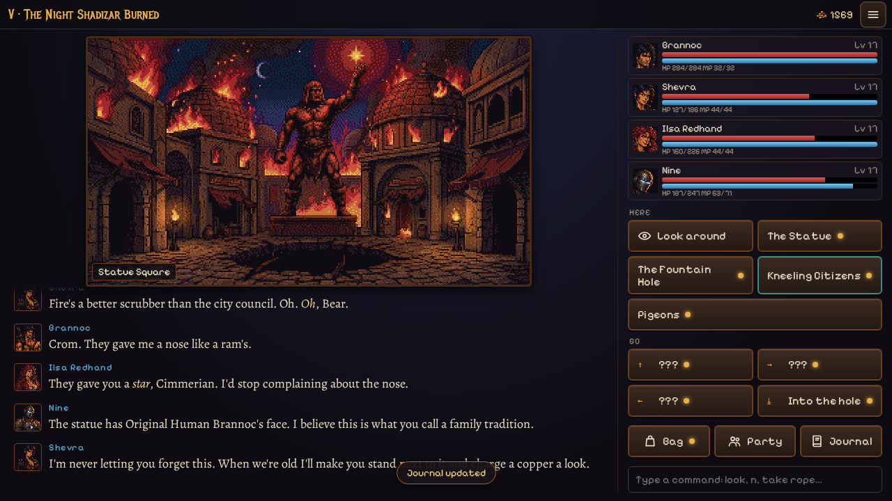

# BarbarAIn

*Steal a star. Cross the sea. Outrun a thousand years. Kill the dragon between worlds.*

A sword-and-sorcery text adventure RPG in the Hyborian Age, with 16-bit pictures. You are Brannoc, a broke Cimmerian who takes one heist job in Shadizar, the City of Thieves. The "jewel" he steals turns out to be the beating heart of an iron man from the far future. Read richly described scenes, solve sly item puzzles, fight turn-based battles with a party of rogues, pirates and sorcerers, and make one choice halfway through that decides which endings exist at all.

**Play it locally** (see [Playing locally](#playing-locally) below). It works on desktop and on phones, with no install.

## The world

Five chapters, about two hours, three endings and three side quests.

| | |
|---|---|
|  **I. The City of Thieves.** Shadizar, a fence's job, a tower full of hounds and a door that only opens if you make it laugh. |  **Battles.** Every weapon slashes, stabs or smashes, and every foe is weak to something. Swap to your sidearm when it counts. |
|  **II. The Black Coast.** A pirate queen in a cell, a vain harbour master, smugglers' tunnels and a sea serpent in the storm. |  **III. The Isle of the Iron Dead.** A jungle full of fallen iron men, and the choice that changes everything. |
|  **IV. A Thousand Years Before.** A heist on a waking dragon's hoard, before Shadizar was ever built. |  **V. The Night Shadizar Burned.** Home again, and the city is on fire. |

Side quests: fight your way up the five ranks of **the Pit of Shadizar**, brew a love potion for **the Salt Witch**, and lay **the Weeping Bride**'s ghost captain to rest.

## How to play

- **Explore:** read the scene, then use **Here** (people and things: Look, Talk, Take, Use an item on it) and **Go** (the ways out). A gold dot means something new.
- **Puzzles:** carry things around, use them on people and objects, and combine two items in the **Bag**. Stuck? The **Journal** has your objective and a two-step hint.
- **Battle:** pick Attack, Skills, Items, Defend or Swap for each fighter, then a target. **Auto** fights for you; **Repeat** does last round again. Battle speed is in Settings.
- **Gear:** the Bag shows who gains what from every item; **Best gear** equips the strongest kit in one tap.
- **Keyboard:** arrows or N/E/S/W to move, L look, I bag, P party, J journal, M map, 1–9 for choices, Space to continue, Esc for the menu. On wide screens you can also type commands like `take rope` or `use grapnel on wall`.
- **Phone:** everything is on big buttons at the bottom; tap the room's name to shrink the picture and get more room for the story. You can install it from your browser's menu and play full screen, even offline.

The game autosaves every time you enter a room, and has three save slots. Losing a battle lets you retry it straight away. Before the big choice and before the final choice the game keeps special saves, so you can go back and find the other endings.

## Playing locally

BarbarAIn is a plain web page with no build step. Serve the `game` folder with any static web server, for example:

    cd game
    python3 -m http.server 8000

then open http://localhost:8000. (Browsers won't run it from a double-clicked file.)

## Credits

An original story set in the Hyborian Age created by Robert E. Howard (1906–1936). Brannoc and every character in this game are original.

Fonts, bundled in `game/fonts/` with their licenses: Metal Mania (SIL Open Font License), Alegreya by Huerta Tipográfica (SIL Open Font License), Pixelify Sans (SIL Open Font License).

Music and sound effects created with ElevenLabs.
